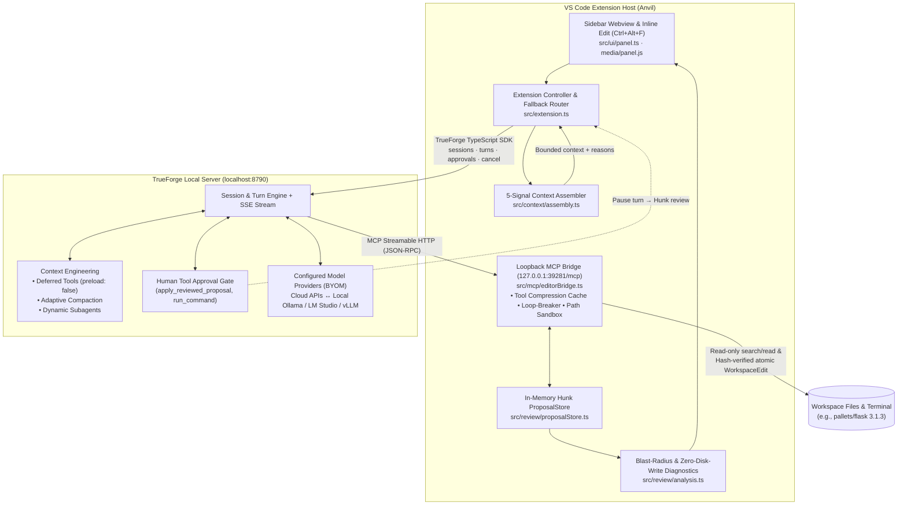
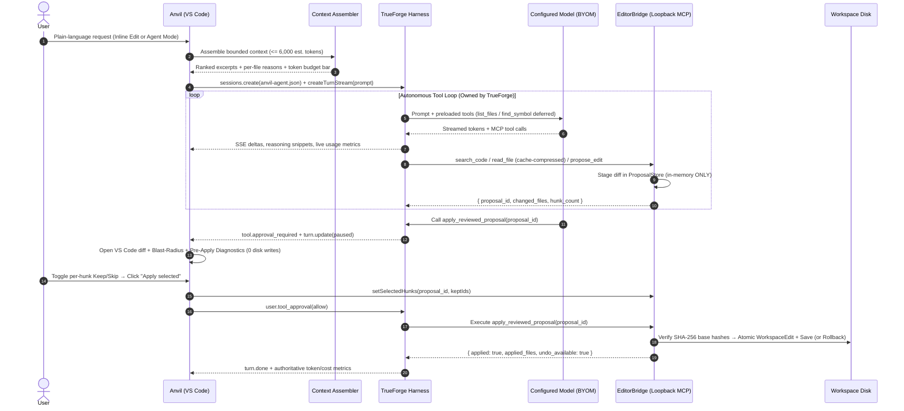
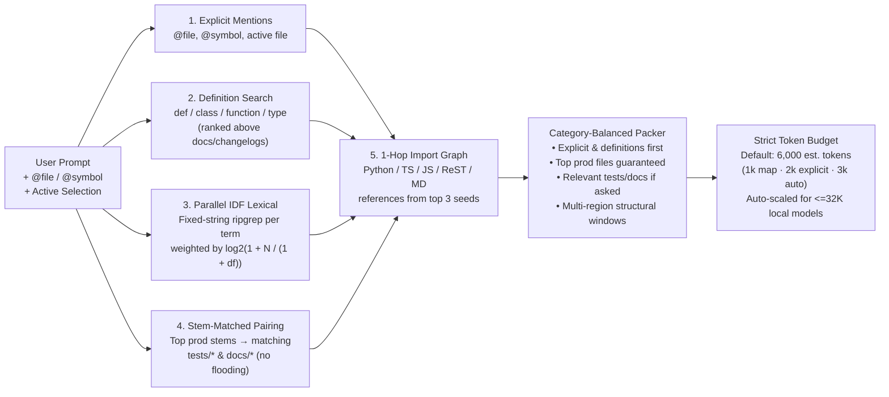
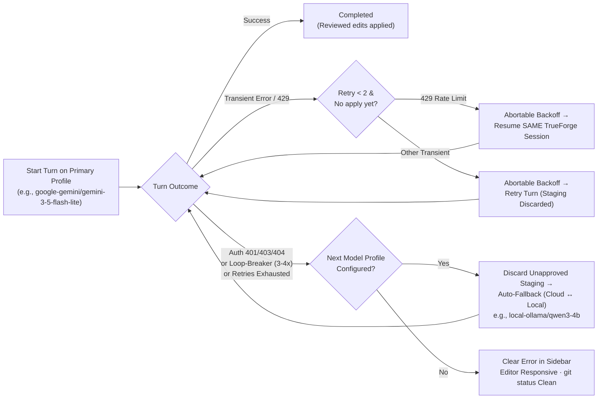

# Anvil

**An editor-native VS Code coding agent whose agent loop runs strictly on [TrueForge](https://github.com/truefoundry/trueforge) local mode.**

> Built **from scratch** for the **Techfest IIT Bombay × TrueFoundry Forge-a-thon (2026–27)**. No upstream editor-agent fork. MIT License — see [LICENSE](LICENSE).

[](tsconfig.json)
[](package.json)
[](agent/anvil-agent.json)
[](src/mcp/editorBridge.ts)
[](tests)
[-success)](#measured-accuracy--benchmarks)
[](LICENSE)

---

## Why Anvil?

AI coding assistants routinely fail in three predictable ways: they lose track of the right files in large repositories, silently corrupt code outside what you asked to change, or hang/crash when the upstream model fails.

**Anvil** delegates the entire agent loop—sessions, turns, SSE streaming, tool orchestration, context compaction, subagents, and tool approvals—to **TrueForge**, focusing 100% of extension engineering on the two hardest problems in coding agents:

1. **High-Precision, Budgeted Context Assembly** — finding the exact production, test, and documentation files in repositories larger than any context window, with transparent per-file reasons and strict token budgets.
2. **Zero-Silent-Write, Blast-Radius Diff Safety** — staging every edit strictly in memory, running pre-apply syntax and VS Code language diagnostics *before* a single byte hits disk, letting humans keep or skip individual hunks, and guaranteeing atomic apply, rollback, and 1-click undo.

---

## Key Differentiators

| Capability | Typical Extension | **Anvil on TrueForge** |
|---|---|---|
| **Agent Loop Ownership** | Custom loop calling OpenAI/Gemini directly | **100% TrueForge harness** (SDK sessions, SSE turns, approvals, zero direct provider calls) |
| **TrueForge Context Engineering** | Basic session/turn wrapper | **3 harness features combined:** Deferred tool loading (`preload: false`), adaptive compaction (`28K` / `65%` of `<=32K` local `contextLength`), and dynamic subagents (`dynamicSubAgents: true` in Agent Mode) |
| **Context Assembly** | Naive file stuffing or `@file`-only | **5-signal retrieval** (explicit mentions + definition-aware symbol search + parallel IDF ripgrep + stem-matched test/doc pairing + 1-hop import graph) with category-balanced packing and **100% (30/30) recall on Flask 3.1.3** |
| **Pre-Apply Verification** | Discovers broken syntax only *after* writing to disk | **Zero-disk-write Pre-Apply Diagnostics** (virtual preview `vscode.languages.getDiagnostics()` + Python AST / JSON syntax checks) + **Blast-Radius Intent Tabs** (`Production` / `Test` / `Docs` / `Config`, `+N/-M`, touched symbols) |
| **Tool-Loop Efficiency** | Repeated `read_file` / `search_code` calls burn context | **Hash-Verified MCP Tool Compression Cache** deduplicates unchanged reads/searches and trims already-read line prefixes, with live token-savings telemetry |
| **Resilience & Runaway Protection** | Static error or infinite retry loops | **Loop-Breaker Guard** (recovery hint on 2nd identical tool error, auto-abort on 3rd–4th) + abortable retry/resume on `429` + automatic **Hybrid Cloud ↔ Local Fallback** |
| **Provider Lock-In (BYOM)** | Hard-coded single provider | Universal **`+ Connect API`** wizard registers OpenAI, Anthropic, Gemini, OpenRouter, Groq, DeepSeek, NVIDIA NIM, Together, Fireworks, Ollama, LM Studio, vLLM, or any custom `/v1` endpoint strictly inside local TrueForge |

---

## System Architecture



---

## End-to-End Data Flow (Zero-Silent-Write Edit Loop)

Every workspace mutation passes through an explicit **in-memory staging → pre-apply diagnostics → TrueForge approval → hash-verified atomic apply** pipeline:



---

## Context Assembly Pipeline

Repositories like `pallets/flask` 3.1.3 (~17,000 lines across `src/`, `tests/`, and `docs/`) exceed small and local context windows. Anvil's [`assembleContext`](src/context/assembly.ts) runs a deterministic, general-purpose **5-signal retrieval and category-balanced packing pipeline** before the first model turn:



---

## Measured Accuracy & Benchmarks

### 1. Context Retrieval Accuracy on `pallets/flask` 3.1.3 (12-Task Benchmark)

We evaluated [`assembleContext`](src/context/assembly.ts) on the pinned competition repository (`pallets/flask` tag `3.1.3`, commit `22d92470`) across **Task A**, **Task B**, and **10 unseen multi-file Flask engineering tasks** (covering blueprints, sessions, JSON provider, `MethodView`, explicit `@symbol`, app context, signals, config, testing client, and templating):

```mermaid
xychart-beta
    title "Flask 3.1.3 Context Assembly Accuracy (12 Tasks / 30 Target Files)"
    x-axis ["Target File Recall (%)", "Full-Task Exact Pass (%)"]
    y-axis "Score (%)" 0 --> 100
    bar [63.3, 16.7]
    bar [100.0, 100.0]
```


*(Left bars: initial heuristic baseline — 63.3% recall / 16.7% full-task pass. Right bars: Anvil 5-signal IDF + definition-aware + stem-paired retriever — **100.0% recall / 100.0% full-task pass**.)*

| # | Benchmark Task (`pallets/flask` 3.1.3) | Expected Target Files | Baseline | **Anvil v0.1** | Budget Used |
|---|---|---|---|---|---|
| 1 | **Task A:** Inline edit `get_debug_flag` | `src/flask/helpers.py` | 1/1 | **1/1 PASS** | 3,192 / 6,000 |
| 2 | **Task B:** Unprompted `flask config` (CLI + test + docs) | `src/flask/cli.py`, `tests/test_cli.py`, `docs/cli.rst` | 3/3 | **3/3 PASS** | 3,233 / 6,000 |
| 3 | Unseen: Blueprints `url_prefix` + tests + docs | `src/flask/blueprints.py`, `tests/test_blueprints.py`, `docs/blueprints.rst` | 2/3 | **3/3 PASS** | 3,161 / 6,000 |
| 4 | Unseen: `SecureCookieSessionInterface` SameSite + tests + docs | `src/flask/sessions.py`, `tests/test_basic.py`, `docs/config.rst` | 1/3 | **3/3 PASS** | 3,151 / 6,000 |
| 5 | Unseen: `DefaultJSONProvider` dumps/loads + tests | `src/flask/json/provider.py`, `tests/test_json.py` | 1/2 | **2/2 PASS** | 2,953 / 6,000 |
| 6 | Unseen: `MethodView` `dispatch_request` + tests + docs | `src/flask/views.py`, `tests/test_views.py`, `docs/views.rst` | 2/3 | **3/3 PASS** | 3,037 / 6,000 |
| 7 | Unseen: Explicit `@symbol(send_from_directory)` | `src/flask/helpers.py` | 0/1 | **1/1 PASS** | 3,323 / 6,000 |
| 8 | Unseen: `request_ctx` / `app_ctx` push & pop + tests | `src/flask/ctx.py`, `tests/test_appctx.py` | 1/2 | **2/2 PASS** | 3,076 / 6,000 |
| 9 | Unseen: `request_started` signals + tests + docs | `src/flask/signals.py`, `tests/test_signals.py`, `docs/signals.rst` | 2/3 | **3/3 PASS** | 3,050 / 6,000 |
| 10 | Unseen: `Config.from_prefixed_env` + tests + docs | `src/flask/config.py`, `tests/test_config.py`, `docs/config.rst` | 2/3 | **3/3 PASS** | 3,310 / 6,000 |
| 11 | Unseen: `FlaskClient` cookies + tests + docs | `src/flask/testing.py`, `tests/test_testing.py`, `docs/testing.rst` | 2/3 | **3/3 PASS** | 3,084 / 6,000 |
| 12 | Unseen: `render_template_string` + tests + docs | `src/flask/templating.py`, `tests/test_templating.py`, `docs/templating.rst` | 2/3 | **3/3 PASS** | 3,113 / 6,000 |
| | **Total / Average** | **30 target files across 12 tasks** | **19/30 (63.3%) · 2/12 pass** | **30/30 (100.0%) · 12/12 pass** | **Avg 3,140 / 6,000 (52.3%)** |

### 2. Automated Verification Suite (`npm run check`)

All **23 unit & integration tests** pass in ~5 seconds across four test modules:

| Suite | Tests | Verified Guarantees |
|---|---|---|
| [`tests/context.test.ts`](tests/context.test.ts) | 6 / 6 | Explicit `@file`/`@symbol` parsing, workspace containment, 1-hop Python & TS import graph, pinned Flask Task B & unseen multi-file generalization, strict token budgets |
| [`tests/mcp.test.ts`](tests/mcp.test.ts) | 1 / 1 *(end-to-end suite)* | Streamable HTTP MCP transport, Origin/Host CSRF rejection (`403`), path/symlink/secret (`.env`) containment, bounded `read_file` pagination, duplicate read/search compression & prefix trimming, Loop-Breaker 2x hint / 3x trip, actionable `propose_edit` anchor diagnostics, in-memory staging, per-hunk apply, 1-click Undo, and multi-file atomic rollback on save failure |
| [`tests/review.test.ts`](tests/review.test.ts) | 6 / 6 | Explicit hunk selection enforcement, multi-file proposal aggregation, CRLF & new-file preservation, stale proposal rejection, Blast-Radius intent grouping & symbol extraction, zero-disk-write Python AST & JSON pre-apply syntax diagnostics |
| [`tests/trueforge.test.ts`](tests/trueforge.test.ts) | 10 / 10 | Checked-in `anvil-agent.json` spec injection, paused approval handshake, terminal failure handling, same-session `429` resume, deferred `call_tool` + compaction + subagent events, Loop-Breaker cancellation, live/final token & cost telemetry, and BYOM Cloud/Local provider registration |

---

## Resilience & Hybrid Cloud ↔ Local Fallback



---

## MCP Tool Surface & Security Model

All workspace capabilities are exposed to TrueForge over a strict loopback-only MCP server (`http://127.0.0.1:39281/mcp`):

| MCP Tool | Loading Mode | TrueForge Approval Gate | Safety & Efficiency Controls |
|---|---|---|---|
| `search_code` | Preloaded | No (read-only) | Excludes `.git`/`.venv`/`node_modules`, caps matches (`<= 30`), session query deduplication cache |
| `read_file` | Preloaded | No (read-only) | Relative path + symlink containment, blocks `.env`/`.npmrc`/`.pypirc`/`.netrc`, 120-line cap, hash-verified duplicate/prefix compression |
| `propose_edit` | Preloaded | No (in-memory only) | Never touches disk; exact unique anchor replacement with line-numbered mismatch diagnostics & line-prefix warning; CRLF preserved |
| `apply_reviewed_proposal` | Preloaded | **Required** | Pauses TrueForge turn for VS Code per-hunk review + pre-apply diagnostics; verifies SHA-256 base hashes; atomic `WorkspaceEdit` + rollback + Undo |
| `run_command` | Preloaded | **Required** | Separate modal command confirmation in VS Code; exact approved command match enforced; abortable on Cancel; 120s timeout |
| `list_files` | **Deferred** (`preload: false`) | No (read-only) | Discovered on demand via TrueForge tool discovery; workspace-contained globbing |
| `find_symbol` | **Deferred** (`preload: false`) | No (read-only) | Uses VS Code workspace symbol providers with text fallback |

---

## Requirements

- **Node.js 22.14+** and **npm**
- **VS Code 1.96+**
- **TrueForge** running locally (`npx @truefoundry/trueforge@latest`)
- Any tool-calling model configured in TrueForge (cloud API free/paid tier, AI gateway, or local Ollama / LM Studio / vLLM). **Anvil never stores API keys in VS Code settings or commits secrets to Git.**
- `rg` (ripgrep) on `PATH` recommended for fast context assembly (automatic bounded filesystem fallback included).

---

## Clean-Clone Setup

```powershell
git clone https://github.com/anugrahks19/anvil.git
cd anvil
npm ci
npm run check
```

### 1. Start TrueForge locally (separate terminal)

```powershell
New-Item -ItemType Directory -Force .demo/trueforge | Out-Null
$env:SQLITE_PATH = Join-Path $PWD '.demo/trueforge/db.sqlite'
$env:OUTBOUND_URL_ALLOWED_HOSTS = '["127.0.0.1"]'
npx --yes --cache .demo/npm-cache @truefoundry/trueforge@0.185.1
```

> `OUTBOUND_URL_ALLOWED_HOSTS='["127.0.0.1"]'` permits local TrueForge to call the loopback MCP bridge (`127.0.0.1:39281`) and optional local runtimes such as Ollama (`127.0.0.1:11434`). Use only in local mode.

### 2. Launch Anvil in VS Code

- Press **F5** using the **`Run Anvil`** launch configuration (or **`Run Anvil in pinned Flask`** for the competition repo), **or**
- Build and install the VSIX:
  ```powershell
  npm run package
  code --install-extension anvil-0.1.0.vsix
  ```
- Open a workspace folder and trust it if prompted. Anvil starts its loopback MCP bridge at `http://127.0.0.1:39281/mcp`.

### 3. Register the MCP Connector & Model Provider in TrueForge

1. Open <http://localhost:8790> → **Settings → Connectors → Add MCP Server**:
   - **Name:** `anvil-editor`
   - **URL:** `http://127.0.0.1:39281/mcp`
   - **Auth:** None
2. In VS Code, open the **Anvil** sidebar (Explorer view) and click **`+ Connect API`** (or run **Anvil: Connect Model API (Cloud or Offline)**) to connect any cloud or local provider directly into TrueForge.
3. Click **`Manage`** to choose and order active profiles in `anvil.modelProfiles` (see [config/model-profiles.example.json](config/model-profiles.example.json)).
   - For Ollama, set `num_ctx` to at least `16384`–`32768`; when `anvil.contextBudgetTokens` is `0`, Anvil automatically scales both context budgets and TrueForge compaction triggers for `<= 32K` models.

The checked-in agent definition is [agent/anvil-agent.json](agent/anvil-agent.json); Anvil injects the active model name and MCP connector name from extension settings on each session.

---

## Using Anvil

### Inline Edit (`Ctrl+Alt+F` / `Cmd+Alt+F`)
1. Select code in a saved file and press **`Ctrl+Alt+F`** (or run **Anvil: Inline Edit**).
2. Type a plain-language edit instruction.
3. Anvil streams the TrueForge turn, opens a native VS Code diff, runs zero-disk-write pre-apply diagnostics, and shows per-hunk **Keep / Skip** toggles.
4. Click **Apply selected** (or **Reject all**). Click **↩ Undo** to revert the last applied edit cleanly.

### Agent Mode (Multi-File)
1. Open **Anvil** in the Explorer sidebar (or run **Anvil: Open Agent**).
2. Describe a multi-file change without naming files (optional `@file:path` and `@symbol:name` mentions are supported).
3. Inspect the live telemetry strip (turns, tool calls, context budget, tokens, cache hit %, compression savings, elapsed time, cost/`Local $0`), chosen context cards with reason pills, streamed output, tool activity, and **Inspect ↗** to open the TrueForge session directly.
4. Click **Stop** at any point to cancel mid-flight and discard unapproved proposals without touching disk.

---

## Reproducing the Fixed Flask 3.1.3 Tasks

Clone the pinned target outside the extension source tree (or into the gitignored `.demo/` directory):

```powershell
git clone --branch 3.1.3 --depth 1 https://github.com/pallets/flask.git .demo/flask
git -C .demo/flask rev-parse HEAD
# Expected: 22d924701a6ae2e4cd01e9a15bbaf3946094af65
```

Set up Flask's Python test environment (Flask 3.1.3 CLI tests require `pytest<9`):

```powershell
Set-Location .demo/flask
python -m venv .venv
'.venv/' | Add-Content .git/info/exclude
.\.venv\Scripts\python.exe -m pip install -e . 'pytest<9' python-dotenv asgiref greenlet
.\.venv\Scripts\python.exe -m pytest tests/test_cli.py -q
```

Use **`Run Anvil in pinned Flask`** (F5) and run the three competition tasks in order (see [docs/submission.md](docs/submission.md) for the exact verification commands, including [docs/flask_demo_app.py](docs/flask_demo_app.py) for masked JSON output):

- **Task A (Inline Edit + Undo):** Select `get_debug_flag` in `src/flask/helpers.py`, apply the exact instruction, verify `FLASK_DEBUG=off` prints `False`, then demonstrate **↩ Undo**.
- **Task B (Agent Mode + TrueForge Session):** Submit the exact `flask config` prompt with no file names, inspect chosen context & reasons, review hunks across 3+ files, click **Inspect ↗** to show TrueForge turns/tool calls, verify `pytest tests/test_cli.py -q` and masked JSON output.
- **Task C (Resilience):** Point the primary profile at an unreachable endpoint (e.g., `http://127.0.0.1:39282/v1`) or invalid key, repeat Task A, show responsive UI + automatic fallback (or clear error), and confirm `git status` is clean.

---

## Development & Optional Live Test

```powershell
npm run typecheck   # TypeScript strict check
npm test            # 23 unit & MCP/TrueForge integration tests
npm run build       # Bundle dist/extension.js via esbuild
npm run package     # Full check + package anvil-0.1.0.vsix
```

To run the optional live integration test against a running local TrueForge server and disposable copy of `.demo/flask`:

```powershell
$env:ANVIL_LIVE_MODEL = 'google-gemini/gemini-3-5-flash-lite'
npm test                  # Runs live Task A end-to-end + Undo verification
$env:ANVIL_LIVE_TASK = 'B'
npm test                  # Runs live Task B end-to-end (3+ files, pytest, masked JSON)
Remove-Item Env:ANVIL_LIVE_MODEL, Env:ANVIL_LIVE_TASK
```

---

## Project Structure

```text
anvil/
├── agent/
│   └── anvil-agent.json             # Checked-in TrueForge agent definition
├── config/
│   └── model-profiles.example.json  # Example BYOM fallback profile configuration (no keys)
├── docs/
│   ├── flask_demo_app.py            # Demo Flask app for verifying Task B JSON masking
│   └── submission.md                # Round 1 demo & submission checklist
├── media/
│   ├── panel.css                    # Sidebar webview styles
│   └── panel.js                     # Interactive hunk review, blast-radius tabs, telemetry UI
├── src/
│   ├── extension.ts                 # VS Code activation, commands, retry/fallback orchestrator
│   ├── context/assembly.ts          # 5-signal budgeted context assembler + 1-hop import graph
│   ├── mcp/editorBridge.ts          # Loopback MCP server, tool cache, loop-breaker, atomic apply
│   ├── review/proposalStore.ts      # In-memory multi-file hunk staging & selective patch apply
│   ├── review/analysis.ts           # Blast-radius intent classification & pre-apply syntax checks
│   ├── trueforge/client.ts          # TrueForge TypeScript SDK wrapper & BYOM provider registration
│   └── ui/panel.ts                  # Webview view provider & strict CSP HTML shell
├── tests/                           # 23 automated tests (context, MCP, review, TrueForge client)
├── LICENSE                          # MIT License
└── package.json                     # VS Code extension manifest
```

---

## Known Limitations & Roadmap

- **Single workspace root per window:** The MCP bridge currently serves the primary workspace folder (`workspaceFolders[0]`).
- **Lexical + graph retrieval (no embeddings):** Fast and deterministic with 100% recall on Flask 3.1.3, though semantic synonym search on unfamiliar terminology would benefit from a lightweight local index.
- **Character-estimated token budgets:** Pre-send budgeting uses `ceil(chars / 4)` rather than model-specific tokenizers (authoritative usage is reported live from TrueForge turn metrics).
- **Safe undo guard:** 1-click Undo intentionally refuses to overwrite files modified externally after apply; Git remains recommended for longer history.
- **Round 2 TrueForge Harness PR Plan:** TrueForge's `CatalogMemoryProvider` currently ships only hosted `zep`. With another month (and for Round 2), we plan to contribute a **built-in Local SQLite Memory Provider** upstream to `github.com/truefoundry/trueforge`, plus multi-root workspace support and tree-sitter AST chunking.
