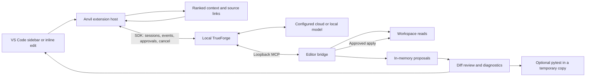

# Anvil

Anvil is a VS Code coding agent built from scratch for the Techfest IIT Bombay and TrueFoundry Forge-a-thon. Use it to edit a selection or request a change across a repository, see why files were selected, and review each hunk before it is applied.

[Quick start](#quick-start) · [Verify the features](#verify-the-features) · [Architecture](#architecture) · [Flask demo](#flask-demo) · [Development](#development)

## Quick start

You need **VS Code 1.96+**, **Node.js 22.14+**, npm, Git, and a tool-calling model available through [TrueForge](https://github.com/truefoundry/trueforge). Install ripgrep for faster retrieval. Anvil has a bounded filesystem fallback when it is unavailable. Python and pytest are needed for Python verification and the Flask demo.

```powershell
git clone https://github.com/anugrahks19/anvil.git
cd anvil
npm ci
npm run check
```

**1. Start local TrueForge** in a separate terminal from the repository root. These commands use the version verified with Anvil.

```powershell
New-Item -ItemType Directory -Force .demo/trueforge | Out-Null
$env:SQLITE_PATH = Join-Path $PWD '.demo/trueforge/db.sqlite'
$env:OUTBOUND_URL_ALLOWED_HOSTS = '["127.0.0.1"]'
npx --yes --cache .demo/npm-cache @truefoundry/trueforge@0.185.1
```

The allowlist permits TrueForge to reach the local editor MCP endpoint and optional loopback model runtimes. The server and its SQLite state are local. Keep the server on localhost.

**2. Start Anvil.** Open this repository in VS Code and press **F5** with **Run Anvil** selected, or build and install the extension in your normal VS Code profile.

```powershell
npm run package
code --install-extension anvil-0.1.1.vsix
```

Open the repository you want to edit in a trusted VS Code workspace. Open **Anvil** in Explorer or run **Anvil: Open Agent**. The sidebar's activity should show the bridge listening on `127.0.0.1:39281`.

**3. Connect TrueForge to the editor.** At <http://localhost:8790>, go to **Settings → Connectors → Add MCP Server**. Register `anvil-editor` at `http://127.0.0.1:39281/mcp` without authentication. If you change the name or port, also update Anvil's settings.

**4. Select a model.** In the Anvil sidebar, click **+ Connect API** to register a cloud provider or an OpenAI-compatible endpoint in TrueForge. You can also configure it directly in TrueForge and use **Manage** in Anvil to add it to your ordered profiles. Anvil references TrueForge model names and sends inference requests through TrueForge. Keep model credentials in local TrueForge configuration. [Example settings](config/model-profiles.example.json)

| Setting | Default or purpose |
| --- | --- |
| `anvil.trueForgeUrl` | `http://localhost:8790` |
| `anvil.mcpServerName`, `anvil.mcpPort` | `anvil-editor`, `39281` |
| `anvil.modelProfiles` | Ordered TrueForge model names. Additional profiles can serve as cloud or local fallback. |
| `anvil.contextBudgetTokens` | `0` for automatic sizing. Normally 6,000 estimated tokens, scaled down for smaller models. |
| `anvil.enableSubagents` | Enables TrueForge research subagents in Agent Mode on supported profiles. Inline edits and local profiles use a single thread. |

## Verify the features

Use a disposable checkout for edits and failure tests. The [Flask demo](#flask-demo) below provides a reproducible baseline.

| Feature | How to check it | Expected result |
| --- | --- | --- |
| **Inline edit** | Save a file, select a function, then press **Ctrl+Alt+F** (**Cmd+Alt+F** on macOS) or run **Anvil: Inline Edit**. Ask for a small change. | The selection and instruction start a TrueForge turn. A native VS Code diff and hunk review appear before any edits land. |
| **Multi-file Agent Mode** | Ask for a change that needs implementation, tests, and docs without naming their paths. Click **Inspect ↗**. | TrueForge shows the session and editor MCP calls. The sidebar lists staged files and the review groups them by intent. Success depends on the model producing a correct patch. |
| **Context retrieval and navigation** | Try `@file:src/flask/helpers.py` and `@symbol:get_debug_flag`, then try a prompt without mentions. Click a file in **Chosen context**. | Explicit references receive priority. Automatic results show per-file reasons, line links, and estimated token use. |
| **Diagnostics and hunk review** | Stage changes in multiple parts of a file. Open its diff and toggle one hunk to **Skip**. | Review shows additions, deletions, touched symbols, category tabs, and available syntax or language diagnostics. The apply count tracks the selection. |
| **Verify selected** | With hunks kept, click **Verify selected**, enter a test path such as `tests/test_cli.py`, and confirm. Change the selection and run it again. | Pytest runs in a temporary copy with just the selected hunks applied. The result belongs to that selection and the real workspace is untouched. Changing the selection hides the old result. You can stop the verification. |
| **Apply, reject, and undo** | Click **Apply selected** and inspect `git diff`. Click **↩ Undo**. In a second run, click **Reject all**. | Only kept hunks are saved. Undo restores the latest applied edit if the files still match. Reject discards the proposal. |
| **Streaming, cancellation, and telemetry** | While a turn is streaming, watch the sidebar and click **Stop** before approval. | Output, tool activity, context budget, and available token and cost metrics update during the run. Stop cancels the TrueForge turn and discards unapproved proposals. |
| **Read compression and loop protection** | Run the MCP integration test from [Development](#development). | Repeated reads are compressed or deduplicated. Identical tool failures produce a recovery hint, then can cancel a runaway loop. |
| **Retry and model fallback** | Select an unreachable provider as the primary profile and optionally configure a working backup. Start an inline edit without approving the result. | The sidebar reports a failure or a switch to the backup and the workspace stays clean. For a recoverable rate limit, Anvil waits and resumes the same TrueForge session with staged work intact. |

**What the pytest check runs:** Anvil uses the workspace `.venv` if present or Python on `PATH`. It copies tracked files from the working tree, overlays the selected hunks and removes the temporary copy after testing. Root dotenv files, common credential dotfiles, symlinks, and unrelated untracked files are excluded. Tracked dotenv fixtures in subdirectories are retained. Tests run with your local user permissions. **Apply selected** remains a separate TrueForge approval.

## Architecture



### Data flow

1. **Assemble context.** Anvil takes the user's instruction, editor selection, and mentions. It ranks candidate files and sends bounded excerpts with the prompt. The sidebar shows what was included and why.
2. **Run the turn.** Anvil opens a session using [the checked-in agent definition](agent/anvil-agent.json), substituting the configured model and connector. TrueForge owns model calls, tool execution, context compaction, subagents, and approval pauses. Anvil renders streamed events from the SDK.
3. **Read and stage.** TrueForge calls the editor bridge over MCP. The model can search and read bounded excerpts, then stage exact text replacements in memory. Repeated reads can return a compressed response.
4. **Review and verify.** An apply request pauses the TrueForge turn. Anvil prepares the native diff, classifies changes, and checks supported buffers. The user chooses hunks and may run pytest on that selection in a disposable copy.
5. **Apply or discard.** On approval, the bridge checks file hashes and applies and saves the selected edits through VS Code. If a save fails, it attempts rollback. Undo checks the current files before restoring the prior state. Agent-requested terminal commands have a separate approval and may have their own side effects.
6. **Recover.** A rate limit before apply can resume the same session after a cancellable delay. If the wait is too long or retries run out, Anvil can try the next profile. It avoids replaying a request after apply has been approved.

### How we built it

Anvil began with a TypeScript VS Code extension and a TrueForge client. We added the loopback MCP bridge so the harness could drive editor tools, then used an in-memory proposal store to separate staging from workspace writes. Context retrieval combines explicit mentions, symbol definitions, lexical ranking, file-name pairing for tests and docs, and one-hop import references. The UI exposes the evidence and its budget. We added read compression, retry and fallback, and review diagnostics, then used a real failing Flask proposal to test running pytest on just the selected hunks.

| Layer | Stack and source |
| --- | --- |
| Editor | TypeScript, VS Code Extension API, native diff and `WorkspaceEdit`. [Extension controller](src/extension.ts) |
| Sidebar | VS Code Webview with HTML, CSS, and vanilla JavaScript. [Panel provider](src/ui/panel.ts) · [UI assets](media/) |
| Agent harness | TrueForge local mode and the TypeScript SDK. SDK events carry streaming, approvals, and usage. [TrueForge client](src/trueforge/client.ts) |
| Editor tools | MCP TypeScript SDK, Streamable HTTP on loopback, Zod input schemas, Node.js filesystem and processes. [Editor bridge](src/mcp/editorBridge.ts) |
| Context | TypeScript, ripgrep with filesystem fallback, lexical and import-graph signals. [Context assembler](src/context/assembly.ts) |
| Review and verification | `diff` hunk generation, SHA-256 base checks, VS Code diagnostics and Python AST or JSON syntax checks, optional Git/Python/pytest snapshot verification. [Review code](src/review/) |
| Build and tests | npm, TypeScript, esbuild, `tsx` with Node's test runner, and `vsce` for packaging. [Manifest](package.json) · [Tests](tests/) |

### MCP tools

| Tool | Role |
| --- | --- |
| `list_files`, `search_code`, `read_file` | Preloaded discovery tools. The bridge scopes paths, bounds output, and caches eligible reads and searches. |
| `find_symbol` | Deferred symbol lookup using VS Code providers with a text search fallback. |
| `propose_edit` | Stages an exact replacement or a new file in memory. |
| `apply_reviewed_proposal` | Requires TrueForge approval and the user's selected hunks. Checks source hashes before writing. |
| `run_command` | Requires TrueForge approval and exact command confirmation in VS Code. Supports timeout and cancellation. |

## Flask demo

Use [pallets/flask](https://github.com/pallets/flask) tag **3.1.3**, commit `22d924701a6ae2e4cd01e9a15bbaf3946094af65`.

```powershell
git clone --branch 3.1.3 --depth 1 https://github.com/pallets/flask.git .demo/flask
git -C .demo/flask rev-parse HEAD
Push-Location .demo/flask
python -m venv .venv
'.venv/' | Add-Content .git/info/exclude
.\.venv\Scripts\python.exe -m pip install -e . 'pytest<9' python-dotenv asgiref greenlet
.\.venv\Scripts\python.exe -m pytest tests/test_cli.py -q
Pop-Location
```

Choose **Run Anvil in pinned Flask** in VS Code. The [demo checklist](docs/submission.md) has the recording sequence and commands.

- **A · Inline edit.** Select `get_debug_flag` in `src/flask/helpers.py`, use the fixed instruction, review the diff, and confirm `FLASK_DEBUG=off` returns `False`. Show Undo.
- **B · Multi-file edit.** Use the fixed `flask config` prompt without filenames. Show the selected context, the three or more changed files, and the TrueForge session. Run `tests/test_cli.py`, confirm `config` appears in `flask --help`, and show masked JSON using the [demo app](docs/flask_demo_app.py).
- **C · Failure and recovery.** Select an unreachable TrueForge model endpoint, repeat A without applying any proposal, and show the error or fallback and clean `git status`.

### Verification status

The latest local `npm run check` passed **24 tests** with Python, pytest, and pinned Flask available. The clean Flask CLI baseline passed **58 tests** inside the pre-apply snapshot. A live TrueForge Task B run reached a four-hunk proposal across three files. Replaying that patch through **Verify selected** caught two CLI regressions before apply. A later live run rejected failing proposals and reached the model's free-tier quota before a passing revision. **Task B remains unverified end to end.** Context retrieval finding the right files is a separate check from the model generating a passing patch.

## Development

```powershell
npm run check      # typecheck, bundle, and run automated tests
npm test           # context, review, MCP, TrueForge client, and pytest snapshot tests
npm run package    # run checks and build the VSIX
```

The automated suite uses mock SDK or editor boundaries where appropriate. The pytest snapshot test skips when Python with pytest is unavailable. The pinned Flask retrieval tests need the checkout above.

To run real model calls against local TrueForge on a disposable Flask copy, set a configured model profile and run the optional harness:

```powershell
$env:ANVIL_LIVE_MODEL = 'google-gemini/gemini-3-5-flash-lite'
npm test  # Task A when ANVIL_LIVE_TASK is unset
$env:ANVIL_LIVE_TASK = 'B'
npm test  # Task B checks 3+ files, pre-apply tests, help, and masked JSON
Remove-Item Env:ANVIL_LIVE_MODEL, Env:ANVIL_LIVE_TASK
```

## Limitations and license

- The bridge serves one workspace root per VS Code window. Retrieval is lexical and graph-based and estimates tokens by character count.
- Models vary in tool use and free-tier capacity. Use a tool-calling model and inspect the proposed changes and test results.
- The temporary verification directory is a file snapshot. It shares your local execution permissions, matches the supplied Python test environment, and does not bring along unrelated untracked files.
- Undo covers the last applied Anvil edit and refuses to overwrite later changes. Use Git for longer history.

MIT licensed. See [LICENSE](LICENSE).
